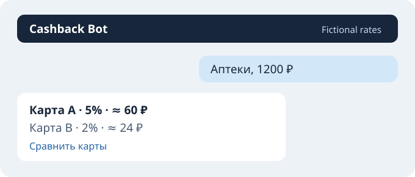
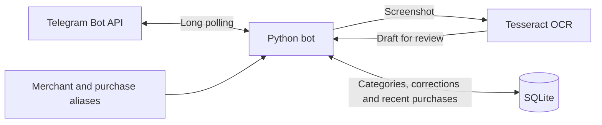

# Cashback Bot

A self-hosted Telegram bot for choosing which card to use at checkout. It compares the monthly rates you have saved and estimates the reward when you include the purchase amount.

## Try the workflow

1. Send a screenshot of your monthly categories, or enter them with `/add`.
2. Choose the bank, review the OCR draft, and confirm the categories.
3. Ask about a store or a category, such as `аптеки, 1200 ₽`.
4. Use **Сравнить карты** to see the saved offers side by side. `/checkout` opens shortcuts and recent purchases.

The bot recognizes aliases in `knowledge.json` and can remember a category correction. The example below uses fictional rates.



Rates depend on your saved offers and the merchant category applied by the bank. Yandex Pay rewards are displayed in Plus points.

## Architecture



## Install on Ubuntu 24.04

1. Create a bot via [BotFather](https://t.me/BotFather).
2. Clone this repository and run `sudo sh deploy/install.sh` from its root. The script installs Tesseract with English and Russian language data and registers a systemd service.
3. Set `TELEGRAM_BOT_TOKEN` in `/etc/cashback-bot.env`. If the bot has a webhook, remove it before starting long polling.
4. Run `sudo systemctl enable --now cashback-bot` and send `/start` to get your Telegram ID. Set `TELEGRAM_OWNER_ID` in the same file, then run `sudo systemctl restart cashback-bot`.
5. Check `sudo systemctl status cashback-bot` and add your first rates. The service stores data in `/var/lib/cashback-bot/cashback.sqlite3`.

The installation is for a single configured owner. Use your own bot and keep service credentials outside the repository.

## Verify

```sh
python3 -m py_compile cashback.py
sh -n deploy/install.sh
```

On your own installation, confirm that a screenshot creates a draft, save a test category, compare cards for a sample purchase, and restart the service to verify persistence.
